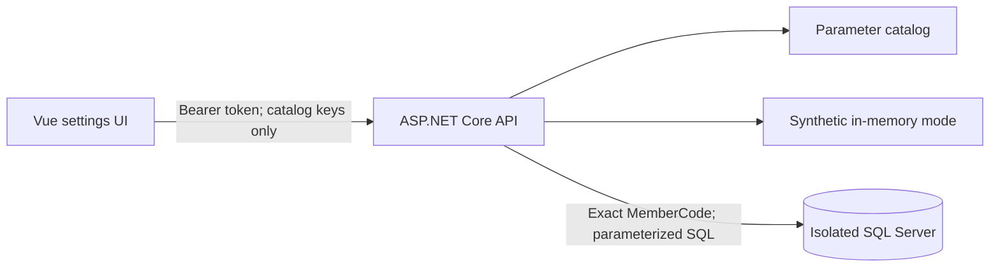

# Architecture

## Components

- `frontend/`: Vue 3 + TypeScript + Vite. The UI imports `docs/parameter-catalog.json` directly, presents original labels/options, supports search and section navigation, tracks dirty state, and calls the local API.
- `backend/B2BStore.Settings.Api/`: ASP.NET Core 10 minimal API, explicit bearer token check, catalog-based validation, mock store, SQL Server store and bitmask editor.
- `docs/parameter-catalog.json`: generated master catalog, currently 93 candidates + 5 unresolved, no verified mappings.
- `tests/`: .NET unit tests and Vue/Vitest tests.
- `B2BStore.Settings.slnx`: .NET 10 solution containing the API and backend test project.

## Request flow

Mock mode begins with synthetic null values and keeps changes only in memory. SQL mode requires an explicit connection and `MemberCode`, verifies a unique row, reads candidate fields when present, and currently rejects every write because none of the mapping statuses is `verified`.

## Safety and concurrency

- Catalog IDs and allowed values are validated server-side.
- Browser-supplied table/column names are never accepted.
- SQL values are parameters; identifiers come only from the catalog and are quoted after strict validation.
- SQL row selection is exact `MemberCode` equality and requires one match.
- SQL update path uses a transaction, expected-value predicates, and affected-row count checks.
- Bitmask operations are calculated in the backend; unknown bits are preserved. Bigint JSON values are strings.
- Production startup requires token, SQL connection and member context; production mock mode is rejected.

## API documentation

See [`openapi.yaml`](openapi.yaml). Swagger UI is not bundled; the OpenAPI document is checked in as the API contract reference.
